  

  
  
  

---

I've been building in Unreal Engine since 2021: shipped games, city-scale digital twins, and conversational MetaHuman agents. Today I lead engineering on real-time and AI projects, and I still write the C++ myself.

<table align="center">
  <tr>
    <td align="center"><b>5+ years</b> Unreal Engine, C++</td>
    <td align="center"><b>3 shipped titles</b> Steam, iOS, Android</td>
    <td align="center"><b>Gold Instructor</b> Epic Games, 3 years running</td>
    <td align="center"><b>Teams of 4+</b> led and mentored</td>
  </tr>
</table>

### What I work on

- **Games.** Gameplay systems, GAS, animation, UI (UMG, CommonUI), and multiplayer, in C++ and Blueprints.
- **Digital twins and smart cities.** Large real-estate and city twins, Mass crowds and traffic, multiplayer Pixel Streaming.
- **AI in real time.** MetaHuman agents that talk, react with emotion and gesture (built for NEOM), plus AI model and SDK integration inside Unreal.
- **Tools and plugins.** Editor tools, C++ plugins (including one on the Epic Online Services subsystem), and third-party SDK integration.

### Shipped titles

| Title | Platform | My part |
|---|---|---|
| [Knights of Light: The Prologue](https://store.steampowered.com/app/1159700/Knights_of_Light_The_Prologue/) | PC (Steam) | Gameplay systems, enemy behavior |
| [Rimal](https://store.steampowered.com/app/2585660/Rimal_Game/) | PC (Steam) | Rewards, battle pass, leaderboard |
| [Vulcan Runner](https://vulcanforged.com) | PC, iOS, Android | Sole developer: gameplay, UI, levels, cross-platform builds |

### Featured repositories

<!-- TODO: replace with the flagship repos once they are public. Pin the same ones on the profile. -->
| Repo | What it shows |
|---|---|
| _coming soon_ | UE5 CommonUI menu and HUD framework (C++) |
| _coming soon_ | Live data plugin that streams IoT / GeoJSON into a UE5 digital twin |
| _coming soon_ | LLM-driven MetaHuman / NPC conversation plugin |

### Credentials and community

- Unreal Authorized Gold Instructor Partner, Epic Games (2025–2027); Authorized Instructor Partner since 2024
- Technical reviewer, *Game Development Patterns with Unreal Engine 5* (Packt, 2023)
- Speaker, NASA Space Apps Challenge 2023, American University in Cairo: two talks on Unreal Engine and real-time development
- M.Sc. Computer Science, University of East London

### Stack

Most of my professional work is under NDA. The repos here are public pieces built to show the same skills. If you'd like a walkthrough of the closed work, get in touch.
